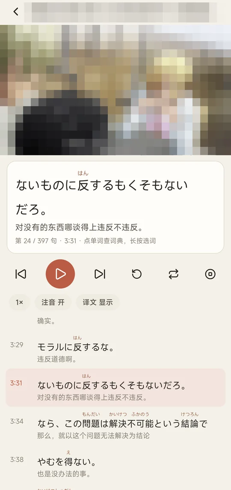
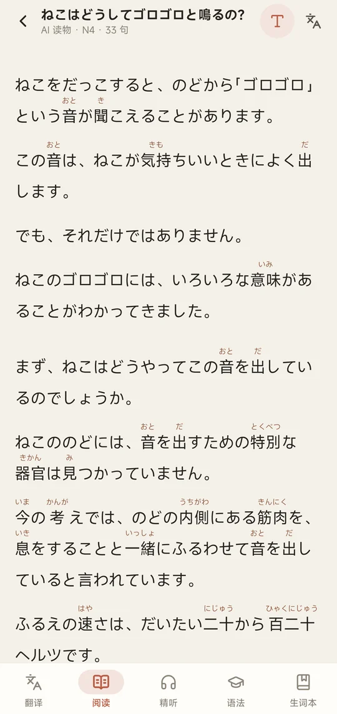
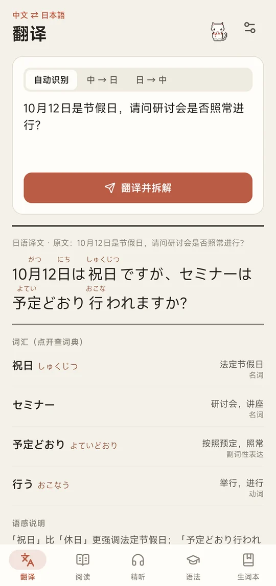
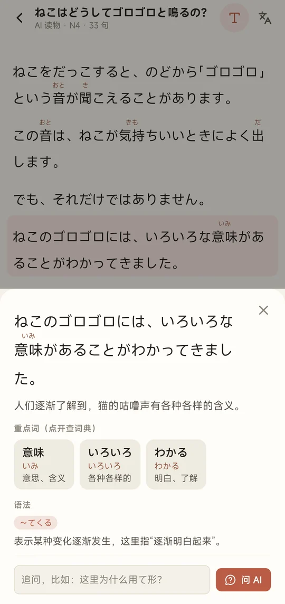
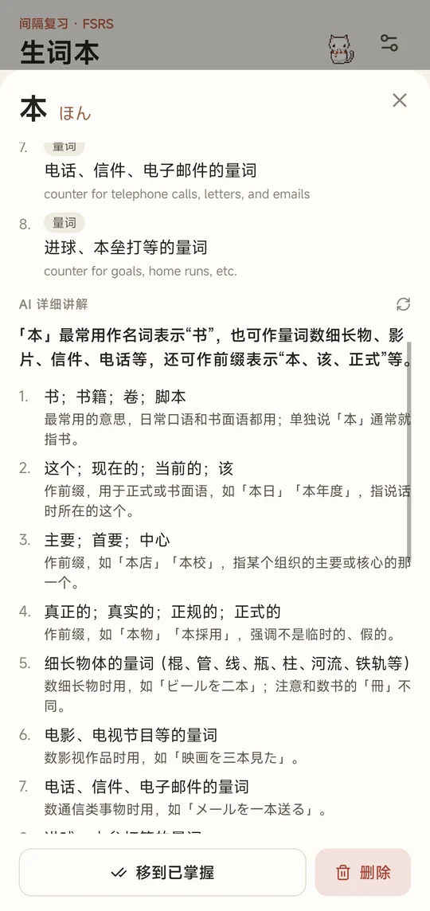
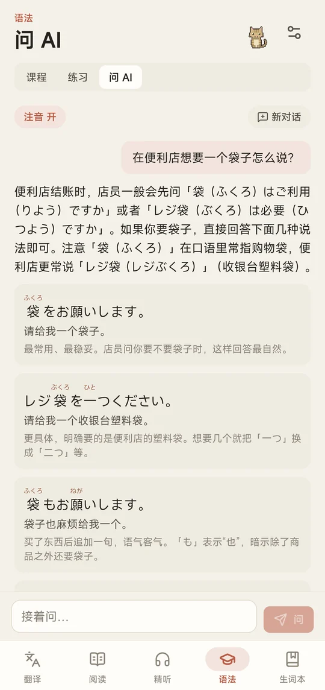
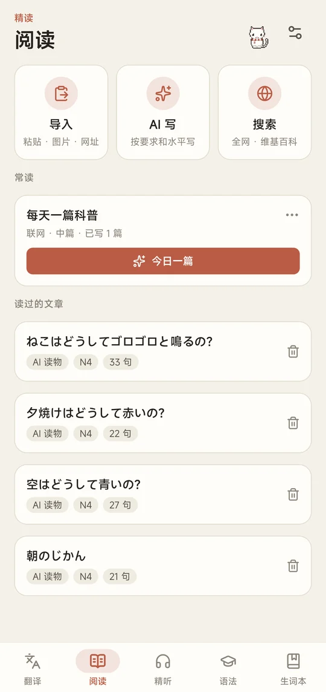
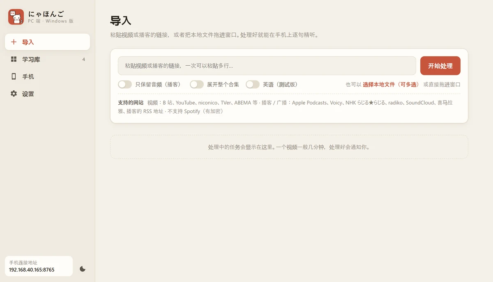
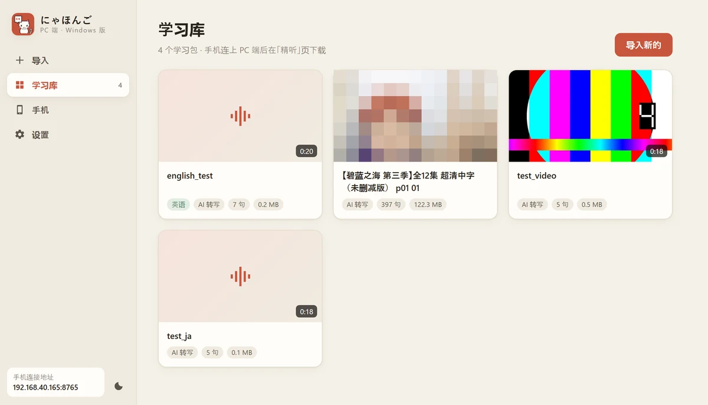
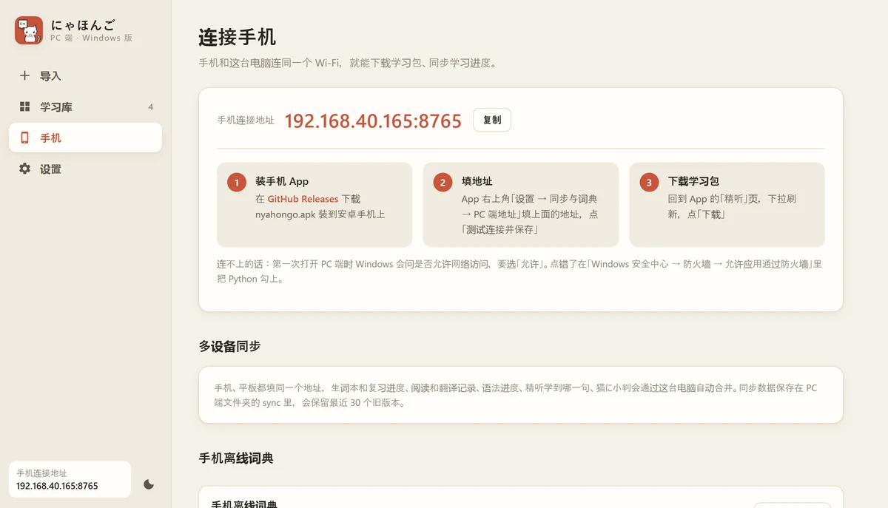

<div align="center">


# にゃほんご

**带注音的 AI 日语学习 App · 动漫日剧逐句精听 · 一只陪你学习的猫**

安卓 App + PC 端（Windows 版） · 免费 · 非商用开源

[下载 App 和 PC 端](../../releases) · [快速开始](#快速开始) · [PC 端](#pc-端windows-版)

</div>

## 为什么选择にゃほんご

<table>
<tr>
<td width="62%">

### 🐱 学习有猫陪，越学越想学

学习的时候攒「小判」（日本古代的金币），每学满 30 分钟掉一个宝箱。开箱收集 **24 只猫、24 件饰品、8 个场景、8 件家具**，全部是手绘像素风，每件都带日语名字和例句。

把猫和家具摆进自己的和风小屋，猫会在里面走来走去，点一下会用日语跟你说话。复习、翻译、读完一篇文章都有小判拿，不知不觉就学了一个小时。

不想要的话，设置里一键切换成「纯净」模式。

</td>
<td width="38%" align="center"></td>
</tr>
<tr>
<td width="62%">

### 🎬 看动漫日剧学日语，免费逐句精听

想跟着动漫、日剧、播客逐句精听，Miraa 这类工具的 AI 转写一般要付费解锁。にゃほんご 的 PC 端在**你自己的电脑上**做语音识别（Whisper），不按分钟收费，想转多少转多少。

粘贴 B 站、YouTube、niconico、播客链接，或者直接拖入电脑里的视频，几分钟后就是一份逐句字幕：AI 校对过、每句带中文翻译、每个汉字都有注音、每个词都能查词典。手机连上电脑下载，地铁上也能一句一句听。

</td>
<td width="38%" align="center"></td>
</tr>
<tr>
<td width="62%">

### ✍️ 一个 App 搞定各种学习，处处都有注音

用 AI 学日语最头疼的是**汉字没有读音**。にゃほんご 里所有日文都稳定显示注音：翻译结果、AI 写的文章、语法课例句、AI 的回答，没有例外。

翻译、阅读、精听、语法课、背单词、问 AI 都在一个 App 里，学到的生词一键收进生词本，按记忆规律复习。长按任何日文都能选词查词，安卓系统的文字菜单里也会多一个「查词」，在别的 App 里也能用。

</td>
<td width="38%" align="center"></td>
</tr>
</table>

## 功能一览

<table>
<tr>
<td align="center" width="33%"></td>
<td align="center" width="33%"></td>
<td align="center" width="33%"></td>
</tr>
<tr>
<td valign="top"><b>翻译</b><br>中日互译，自动拆解词汇和语法，不懂的地方接着追问 AI。</td>
<td valign="top"><b>阅读</b><br>AI 按你的水平写文章（可以先上网查资料），也能拍书页、漫画识别日文、读网页。点一句看译文、重点词和语法。</td>
<td valign="top"><b>生词本</b><br>FSRS 记忆算法安排复习；每个词有词典释义和 AI 详细讲解（用法、搭配、例句、近义词辨析），记牢的自动移到「已掌握」。</td>
</tr>
<tr>
<td align="center"></td>
<td align="center"></td>
<td align="center"></td>
</tr>
<tr>
<td valign="top"><b>语法</b><br>N5～N1 共 828 个语法点排成循序渐进的课程，每课有中文讲解、例句和小测验，<b>装好就能学</b>；还有一句一练，以及「问 AI」：这个语法怎么用、这个场合日语怎么说。</td>
<td valign="top"><b>常读</b><br>把常用的要求存下来（「每天一篇科普」「今天的日本新闻」），每天点一下就有一篇新的，不会重样。</td>
<td valign="top"><b>精听</b><br>单句循环、每句读完自动暂停、调速、横屏左右分栏；点单词查词典，长按自由选词。</td>
</tr>
</table>

另外还有：**多设备同步**（手机、平板连同一台电脑，学习进度自动合并）、**离线词典**（JMdict 21 万词条）、**英语模式**（测试版，英语视频做成中英双语字幕）。

<sub>截图里的视频画面打了马赛克。</sub>

## 快速开始

### 1. 安装 App

在 [Releases](../../releases) 下载 `nyahongo.apk`，传到安卓手机上安装（需要允许「安装未知来源应用」）。目前只有安卓版。

### 2. 填一个 AI 服务的 API Key

翻译、讲解、出题要用 AI，需要你自己申请一个 API Key（按用量付费，日常学习花得很少）。第一次打开 App 会有引导，也可以在「设置 → AI 接口」里填。

| 服务商 | 申请 Key 的网站 | 说明 |
|---|---|---|
| DeepSeek | platform.deepseek.com | 便宜、中文好；**没有看图模型**，用拍照识字要另选一家 |
| DeepInfra | deepinfra.com | 模型多，文字和看图都有（开发时一直用的这家） |
| 阿里云百炼 | bailian.console.aliyun.com | 国内直连，通义千问系列，能看图 |
| 硅基流动 | cloud.siliconflow.cn | 国内直连，开源模型多，能看图 |

填好 Key 后 App 会自动读取这家的模型列表，选一个就能用。

**联网搜索（可选）**：让 AI 写文章前先上网查资料、在「阅读」里搜全网文章，需要 DeepSeek 的 Key（约每千次搜索 5 元人民币）。不填也能用，只能搜日语维基百科。

### 3. 装 PC 端（可选，逐句精听视频需要）

见下一节。App 里「精听」页标题旁的问号里也有图文教程。

## PC 端（Windows 版）



PC 端是一个独立的桌面程序，负责把视频、播客做成学习包：下载 → 语音转文字（视频自带日语字幕时直接用字幕）→ AI 校对和翻译 → 分词、注音、查词典。

需要 **Windows 10 / 11**（64 位）。有 NVIDIA 显卡的话语音转文字会快很多，没有显卡也能用，只是慢一些。Mac 版以后可能会有。

### 安装

1. 在 [Releases](../../releases) 下载 `nyahongo-pc-setup.exe`（约 16 MB），双击安装。不需要管理员权限，装在你自己的用户目录里
2. 国内网络可以勾选「国内网络」：语音识别模型从国内镜像下载
3. 从开始菜单打开「にゃほんご PC 端」。**第一次**会弹出一个准备窗口，自动下载 Python 和需要的组件（约 2.5 GB），没有 ffmpeg 也会自动装，网速慢要等十几分钟，只有这一次
4. 在左边的「设置」里选 AI 服务商、粘贴 API Key、选模型（和手机用同一家就行），改完自动保存。不填也能处理视频，只是字幕没有中文翻译

关掉窗口 PC 端就停了。卸载时下载的组件会一起删掉，学习库和设置会留下。

### 导入视频和播客

在「导入」页粘贴链接、点「开始处理」，或者把电脑里的视频、音频文件拖进窗口。

- **视频**：B 站、YouTube、niconico、TVer、ABEMA 等
- **播客 / 广播**：Apple Podcasts、Voicy、NHK らじる★らじる、radiko、SoundCloud、喜马拉雅、播客的 RSS 地址（Spotify 有加密，不支持）
- 只想听：勾选「只保留音频」，文件小很多
- B 站多 P、YouTube 播放列表：勾选「展开整个合集」，每集一个学习包

<table>
<tr>
<td width="50%"></td>
<td width="50%"></td>
</tr>
</table>

### 连接手机

1. 手机和电脑连同一个 Wi-Fi
2. PC 端窗口左下角显示「手机连接地址」，点进去是「连接手机」页，可以一键复制
3. App 的「设置 → 同步与词典 → PC 端地址」填这个地址，点「测试连接并保存」
4. 回到 App 的「精听」页，下拉刷新，下载学习包；顺便在「设置 → 同步与词典」下载离线词典（约 70 MB，查词更准、省 AI 费用）

第一次打开 PC 端时 Windows 会问是否允许网络访问，要选「允许」。点错了在「Windows 安全中心 → 防火墙 → 允许应用通过防火墙」里把 Python 勾上。

手机、平板都填同一个地址，生词本、复习进度、阅读和翻译记录、语法进度、精听进度、猫屋会自动合并同步。

### 从源码运行

想改代码，或者不想用安装包：

1. 本页面右上角「Code → Download ZIP」，解压到路径里没有空格和中文的文件夹，比如 `D:\nihongo`
2. 在 PowerShell 里安装 uv（Python 环境管理工具）和 ffmpeg，装完重新打开 PowerShell：
   ```powershell
   powershell -ExecutionPolicy ByPass -c "irm https://astral.sh/uv/install.ps1 | iex"
   winget install Gyan.FFmpeg.Essentials
   ```
3. 双击 `pc\启动.bat`，打开后在「设置」里填 AI 的 Key

## 常见问题

**第一次处理视频卡在下载模型 / 下载词典**

语音识别模型（约 3 GB）从 Hugging Face 下载，词典从 GitHub 下载，国内网络可能很慢。在 PC 端「设置 → 语音识别」打开「国内网络」，模型就从国内镜像下载。词典也下载不动的话，在「设置 → 下载」填代理地址，或者关掉 PC 端，在 `pc` 文件夹的地址栏输入 `cmd` 回车，运行（地址换成你自己的代理）：

```bat
set HTTPS_PROXY=http://127.0.0.1:7890
启动.bat
```

**YouTube、niconico 下载失败**

在「设置 → 下载」里填代理地址。需要登录才能看的视频，在同一页选你登录用的浏览器。

**手机连不上电脑**

检查 PC 端窗口还开着、手机没连到别的 Wi-Fi 或在用流量、Windows 防火墙允许了 Python。

**数据存在哪里**

API Key 只保存在你自己的设备上（手机的加密存储、电脑上 PC 端的设置文件）。学习记录存在手机本地；开了同步的话，电脑上 `pc\sync\` 里也有一份（保留最近 30 个旧版本）。App 只会把要处理的内容发给你自己选的 AI 服务。

**AI 讲错了怎么办**

AI 生成的讲解、翻译和例句可能有错，以词典和原始资料为准。查词优先用离线词典（JMdict），词典里没有的词才用 AI 释义，并会标明「AI 释义」。

## 开发

```
app/   安卓 App（Expo / React Native）
pc/    PC 端：下载 → Whisper 转写 → AI 校对 → 分词注音查词 → 打包学习包；桌面窗口（pywebview）、局域网同步
art/   猫に小判的像素美术：art/tools/ 里的 Python 脚本用代码画出所有素材
```

编译 App（需要 JDK 17 和 Android SDK）：

```bash
cd app
npm install
npx expo prebuild --platform android
npx expo run:android --variant release
```

`app/build-apk.bat` 是作者自己用的打包脚本，用环境变量 `NIHONGO_TOOLCHAIN` 指向放 JDK、Android SDK 和 Gradle 缓存的文件夹。PC 端安装包：在 `pc/installer` 里运行 `build.ps1`（需要 Inno Setup 6）。语法课课文用 `pc/tools/pregen_grammar.py` 预先生成。

测试：

```bash
cd app && npx tsc --noEmit && node --test tests/syncMerge.test.mjs
cd pc && uv run pytest
```

PC 端的命令行用法和学习包格式见 [pc/README.md](pc/README.md)。PC 端界面是一套网页（`pc/src/nihongo_pc/web/`），用系统自带的 WebView 显示，以后做 Mac 版可以直接复用。

## 数据来源和许可

- 日语词典：[JMdict](https://www.edrdg.org/jmdict/j_jmdict.html) © Electronic Dictionary Research and Development Group，CC BY-SA 4.0；JSON 版本来自 [jmdict-simplified](https://github.com/scriptin/jmdict-simplified)。中文释义由 AI 翻译 JMdict 的英文义项，词条本身（写法、读音、词性、义项划分）全部来自 JMdict
- 英汉词典（英语模式）：[ECDICT](https://github.com/skywind3000/ECDICT) © skywind3000，MIT
- 语法点：[Hanabira](https://hanabira.org) 开源日语语法库（`app/src/data/grammar.json`，去掉了罗马音），署名后可免费使用；课程编排、中文讲解和练习题由 AI 基于这些资料生成
- 复习算法：FSRS（[ts-fsrs](https://github.com/open-spaced-repetition/ts-fsrs)，MIT）
- 语音识别：[faster-whisper](https://github.com/SYSTRAN/faster-whisper)；分词：SudachiPy；桌面窗口：[pywebview](https://github.com/r0x0r/pywebview)

本项目按 [PolyForm Noncommercial License 1.0.0](LICENSE) 授权：个人学习、研究、非营利用途可以自由使用、修改和分享，**禁止商业用途**。需要商用请联系作者。第三方数据按各自的许可证使用。
