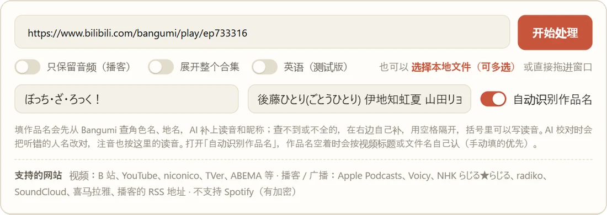
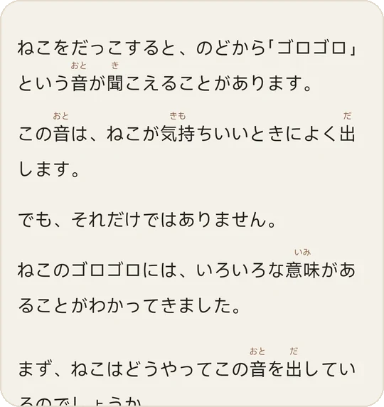
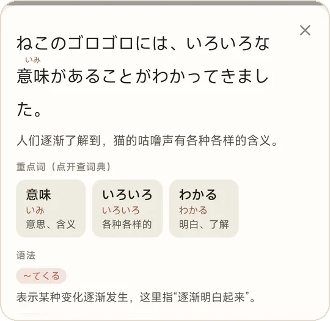
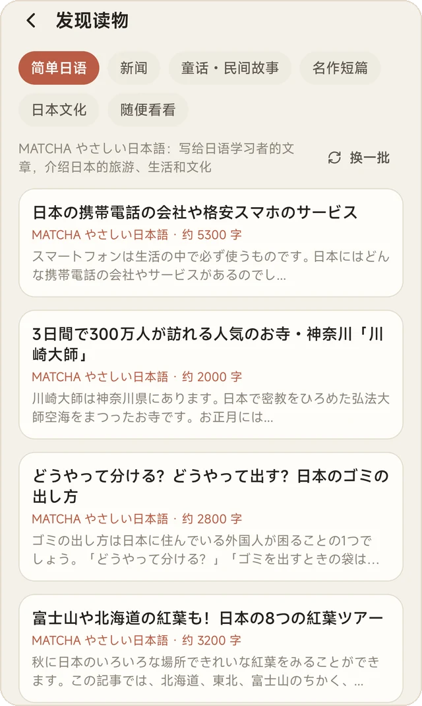
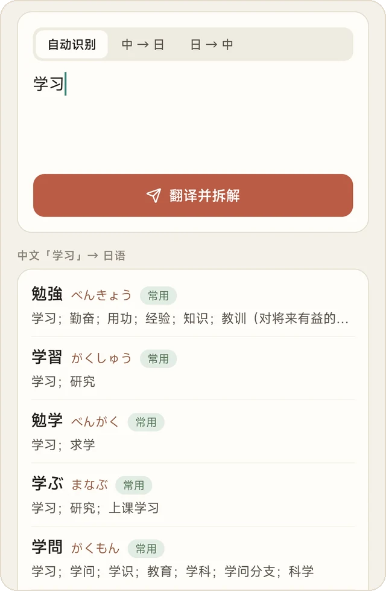
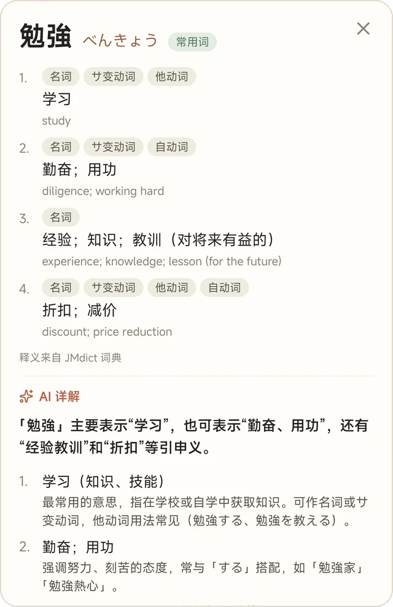
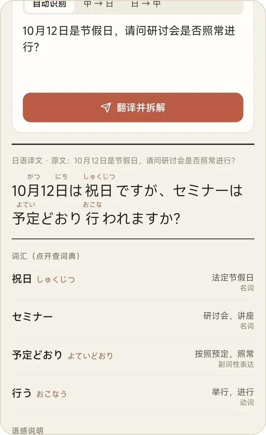
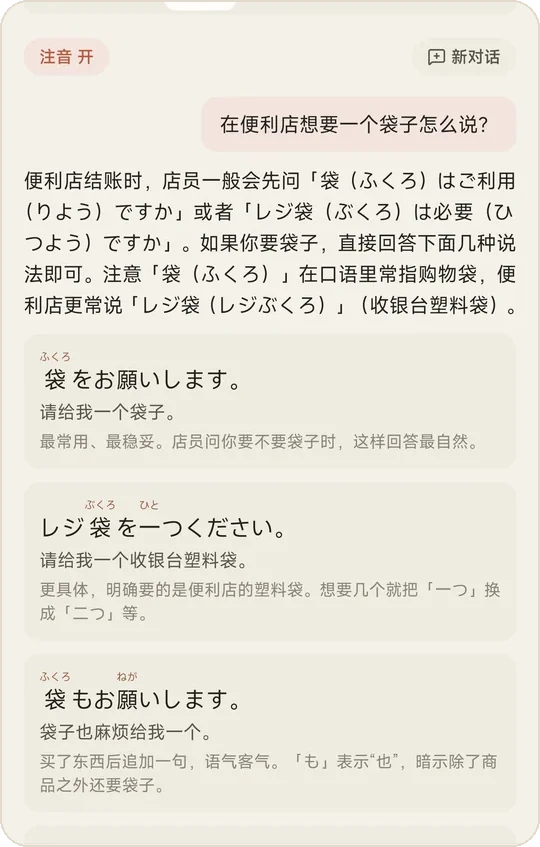
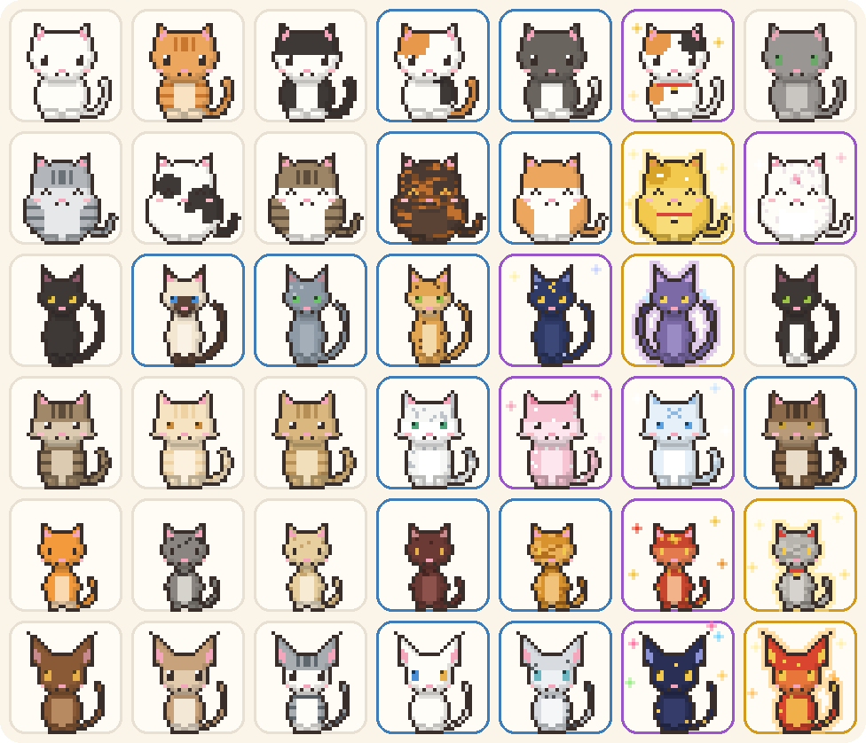
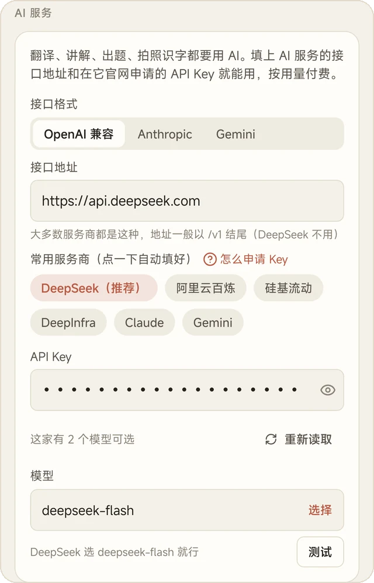

<p align="center"></p>

<p align="center">
<b>带注音的 AI 日语学习 App · 动漫日剧逐句精听 · 42 只陪你学习的像素猫</b><br>
安卓 App + PC 端（Windows 版） · 免费 · 非商用开源<br><br>
<a href="../../releases"><b>⬇ 下载 App 和 PC 端</b></a> &nbsp;·&nbsp; <a href="#快速开始">快速开始</a> &nbsp;·&nbsp; <a href="#pc-端windows-版">PC 端</a>
</p>

---

## 🎬 看动漫日剧，一句一句地听


想跟着动漫、日剧、播客逐句精听，Miraa 这类工具的 AI 转写一般要付费解锁。にゃほんご 的 PC 端在**你自己的电脑上**做语音识别（Whisper），不按分钟收费，想转多少转多少。

粘贴 B 站、YouTube、niconico、播客链接，或者直接拖入电脑里的视频，几分钟后就是一份逐句字幕：

- AI 校对过，每句带中文翻译
- 每个汉字都有注音，每个词点一下就能查
- 单句循环、读完一句自动暂停、调速、横屏分栏

手机连上电脑下载，地铁上也能一句一句听。听完一集按**真正听了多久**给小判，直接拖到结尾不算。

<br clear="right">

<p align="center"></p>

> **人名不再听错**：填上作品名（或打开「自动识别作品名」，从视频标题里自己认），PC 端会先去 [Bangumi](https://bgm.tv) 查角色名和地名，AI 补上读音和昵称，校对时把听错的人名改对，注音也按正确读音。

## ✍️ 所有日文都有注音

用 AI 学日语最头疼的是**汉字没有读音**。にゃほんご 里所有日文都稳定显示注音：翻译结果、AI 写的文章、语法课例句、AI 的回答，没有例外。

**阅读**可以让 AI 按你的水平写文章（先上网查资料再写），也能拍书页、漫画识别日文，或者读网页。读的时候点一句话，下面弹出译文、重点词和语法：

<p align="center">

&nbsp;

</p>

## 🧭 不知道读什么？点「发现」



选个分类，下面马上换一批现成的读物，点开就能读：

| 分类 | 来源 |
|---|---|
| 简单日语 | MATCHA やさしい日本語 |
| 新闻 | NHK ニュース |
| 童话 · 民间故事 | 青空文库 |
| 名作短篇 | 青空文库（宫泽贤治、芥川、太宰…） |
| 日本文化 | 维基百科 |
| 随便看看 | 维基百科随机条目 |

点开一篇会先显示全文，可以删掉不想读的部分；读起来吃力就点「改写成我的水平」。读完一篇按篇幅给小判，长文章给得多。

还可以把常用的要求存成**常读**（「每天一篇科普」「今天的日本新闻」），每天点一下就有一篇新的，不会重样。

<br clear="right">

## 🔍 输入就查，中文也能查日语

在「翻译」页的输入框里打一个词，不用点按钮，下面直接出词典结果。**离线词典**内置在 App 里（JMdict 21 万词条，常用的 2.2 万词有中文释义），没网也能查。

输入中文会自动反查日语：打「学习」，出来 勉強、学習、学ぶ…… 点开词条还能让 AI 详解：例句、用法、近义词辨析。

<p align="center">

&nbsp;&nbsp;

</p>

长按任何日文都能选词查词；安卓系统的文字菜单里也会多一个「查词」，在别的 App 里也能用。

## 💬 翻译、语法、问 AI

**翻译**：中日互译，自动拆解词汇和语法，不懂的地方接着追问 AI。

**语法**：N5～N1 共 828 个语法点排成循序渐进的课程，每课有中文讲解、例句和小测验，**装好就能学**；还有一句一练。

**问 AI**：这个语法怎么用、这个场合日语怎么说，回答里的日文同样带注音。

**生词本**：学到的生词一键收进来，FSRS 记忆算法安排复习，记牢的自动移到「已掌握」。

<p align="center">

&nbsp;&nbsp;

</p>

## 🐱 学习有猫陪


学习的时候攒「小判」（日本古代的金币），有效学习每满 40 分钟掉一个宝箱，花小判开箱。

- **小判**只来自学习行为：复习、翻译、做题、读完文章、听完学习包、学完语法课
- **宝箱**只来自学习时间
- 宝箱多了没用，小判多了还能买宝箱，所以认真学的话小判总是够用

开箱收集 **42 只猫（6 种体型）、32 件饰品、8 个场景、8 件家具**，全部是用代码画出来的像素风，每件都带日语名字和例句。把猫和家具摆进自己的和风小屋，猫会在里面走来走去，点一下会用日语跟你说话。

不想要的话，设置里一键切换成「纯净」模式。

<br clear="right">

<p align="center"><br><sub>全部 42 只猫：每行一种体型，彩色边框是稀有、史诗、传说</sub></p>

## 还有这些

- **多设备同步**：手机、平板连同一台电脑，生词本、复习进度、阅读记录、猫屋自动合并
- **英语模式**（测试版）：英语视频做成中英双语字幕，点单词查英汉词典
- **检查更新**：App 和 PC 端每天自动检查一次新版本

<sub>截图里的视频画面打了马赛克。</sub>

## 快速开始

### 1. 安装 App

在 [Releases](../../releases) 下载 `nyahongo.apk`，传到安卓手机上安装（需要允许「安装未知来源应用」）。目前只有安卓版。

### 2. 填一个 AI 服务



翻译、讲解、出题要用 AI，需要你自己申请一个 API Key（按用量付费，日常学习花得很少）。第一次打开 App 会有引导，也可以在「设置 → AI 接口」里填：接口格式（OpenAI 兼容 / Anthropic / Gemini）、接口地址、API Key。

**推荐 DeepSeek 官方**（platform.deepseek.com）：一个 Key 就能翻译讲解、**拍照识字、联网搜索**，中文好、便宜、国内直接能连。点「常用服务商」里的 DeepSeek 会自动填好地址和模型，旁边的问号里有申请 Key 的图文教程。

也可以用阿里云百炼、硅基流动、DeepInfra、Claude、Gemini，或者填任何兼容的接口地址。这些服务商的文字模型不能看图时，拍照识字可以另选一个看图模型。

填好 Key 后 App 会自动读取这家的模型列表，选一个就能用。

<br clear="right">

### 3. 装 PC 端（可选，逐句精听视频需要）

见下一节。App 里「精听」页标题旁的问号里也有图文教程。

## PC 端（Windows 版）

PC 端是一个独立的桌面程序，负责把视频、播客做成学习包：下载 → 语音转文字（视频自带日语字幕时直接用字幕）→ AI 校对和翻译 → 分词、注音、查词典。

需要 **Windows 10 / 11**（64 位）。有 NVIDIA 显卡的话语音转文字会快很多，没有显卡也能用，只是慢一些。Mac 版以后可能会有。

### 安装

1. 在 [Releases](../../releases) 下载 `nyahongo-pc-setup.exe`（约 16 MB），双击安装。不需要管理员权限，装在你自己的用户目录里
2. 国内网络可以勾选「国内网络」：语音识别模型从国内镜像下载
3. 从开始菜单打开「にゃほんご PC 端」。**第一次**会弹出一个准备窗口，自动下载 Python 和需要的组件（约 2.5 GB），没有 ffmpeg 也会自动装，网速慢要等十几分钟，只有这一次
4. 在左边的「设置」里选 AI 服务商、粘贴 API Key、选模型（和手机用同一家就行），改完自动保存。不填也能处理视频，只是字幕没有中文翻译

关掉窗口 PC 端就停了。卸载时下载的组件会一起删掉，学习库和设置会留下。

### 导入视频和播客

在「导入」页粘贴链接、点「开始处理」，或者把电脑里的视频、音频文件拖进窗口。

- **视频**：B 站、YouTube、niconico、TVer、ABEMA 等
- **播客 / 广播**：Apple Podcasts、Voicy、NHK らじる★らじる、radiko、SoundCloud、喜马拉雅、播客的 RSS 地址（Spotify 有加密，不支持）
- 只想听：勾选「只保留音频」，文件小很多
- B 站多 P、YouTube 播放列表：勾选「展开整个合集」，每集一个学习包
- 动画、日剧可以填「作品名」：PC 端先从 [Bangumi](https://bgm.tv) 查角色名、地名，AI 补上读音和昵称，校对时把听错的人名改对、注音也按正确读音；查不全的在旁边「补充专有名词」里自己加；打开「自动识别作品名」，作品名空着时按视频标题或文件名自己认

<p align="center"> </p>

### 连接手机

1. 手机和电脑连同一个 Wi-Fi
2. PC 端窗口左下角显示「手机连接地址」，点进去是「连接手机」页，可以一键复制
3. App 的「设置 → 同步与词典 → PC 端地址」填这个地址，点「测试连接并保存」
4. 回到 App 的「精听」页，下拉刷新，下载学习包

第一次打开 PC 端时 Windows 会问是否允许网络访问，要选「允许」。点错了在「Windows 安全中心 → 防火墙 → 允许应用通过防火墙」里把 Python 勾上。

手机、平板都填同一个地址，生词本、复习进度、阅读和翻译记录、语法进度、精听进度、猫屋会自动合并同步。

### 从源码运行

想改代码，或者不想用安装包：

1. 本页面右上角「Code → Download ZIP」，解压到路径里没有空格和中文的文件夹，比如 `D:\nihongo`
2. 在 PowerShell 里安装 uv（Python 环境管理工具）和 ffmpeg，装完重新打开 PowerShell：
   ```powershell
   powershell -ExecutionPolicy ByPass -c "irm https://astral.sh/uv/install.ps1 | iex"
   winget install Gyan.FFmpeg.Essentials
   ```
3. 双击 `pc\启动.bat`，打开后在「设置」里填 AI 的 Key

## 常见问题

**第一次处理视频卡在下载模型 / 下载词典**

语音识别模型（约 3 GB）从 Hugging Face 下载，词典从 GitHub 下载，国内网络可能很慢。在 PC 端「设置 → 语音识别」打开「国内网络」，模型就从国内镜像下载。词典也下载不动的话，在「设置 → 下载」填代理地址，或者关掉 PC 端，在 `pc` 文件夹的地址栏输入 `cmd` 回车，运行（地址换成你自己的代理）：

```bat
set HTTPS_PROXY=http://127.0.0.1:7890
启动.bat
```

**YouTube、niconico 下载失败**

在「设置 → 下载」里填代理地址。需要登录才能看的视频，在同一页选你登录用的浏览器。

**手机连不上电脑**

检查 PC 端窗口还开着、手机没连到别的 Wi-Fi 或在用流量、Windows 防火墙允许了 Python。

**数据存在哪里**

API Key 只保存在你自己的设备上（手机的加密存储、电脑上 PC 端的设置文件）。学习记录存在手机本地；开了同步的话，电脑上 `pc\sync\` 里也有一份（保留最近 30 个旧版本）。App 只会把要处理的内容发给你自己选的 AI 服务。

**怎么更新**

App 和 PC 端每天会自动检查一次 GitHub 上有没有新版本，有的话会提示。也可以手动检查：App 在「设置 → 关于」，PC 端在「设置 → 关于与更新」。下载新的安装包直接覆盖安装，学习记录、已填的 Key 和学习库都会保留。

**AI 讲错了怎么办**

AI 生成的讲解、翻译和例句可能有错，以词典和原始资料为准。查词优先用离线词典（JMdict），词典里没有的词才用 AI 释义，并会标明「AI 释义」。

## 开发

```
app/   安卓 App（Expo / React Native）
pc/    PC 端：下载 → Whisper 转写 → AI 校对 → 分词注音查词 → 打包学习包；桌面窗口（pywebview）、局域网同步
art/   猫に小判的像素美术：art/tools/ 里的 Python 脚本用代码画出所有素材
```

编译 App（需要 JDK 17 和 Android SDK）。离线词典（约 76 MB）预装在 App 里，但不放进 git，编译前先准备好 `app/assets/dict/jmdict.sqlite`，二选一：

- 从 [Releases](../../releases) 下载 `jmdict.sqlite`（带 2.2 万常用词的中文释义），放到 `app/assets/dict/`
- 自己生成：`cd pc && uv run python tools/export_phone_dict.py`（第一次会自动下载 JMdict；中文释义只有你电脑上翻译过的部分）

```bash
cd app
npm install
npx expo prebuild --platform android
npx expo run:android --variant release
```

`app/build-apk.bat` 是作者自己用的打包脚本，用环境变量 `NIHONGO_TOOLCHAIN` 指向放 JDK、Android SDK 和 Gradle 缓存的文件夹。PC 端安装包：在 `pc/installer` 里运行 `build.ps1`（需要 Inno Setup 6）。语法课课文用 `pc/tools/pregen_grammar.py` 预先生成。

测试：

```bash
cd app && npx tsc --noEmit && node --test tests/syncMerge.test.mjs
cd pc && uv run pytest
```

PC 端的命令行用法和学习包格式见 [pc/README.md](pc/README.md)。PC 端界面是一套网页（`pc/src/nihongo_pc/web/`），用系统自带的 WebView 显示，以后做 Mac 版可以直接复用。

## 数据来源和许可

- 日语词典：[JMdict](https://www.edrdg.org/jmdict/j_jmdict.html) © Electronic Dictionary Research and Development Group，CC BY-SA 4.0；JSON 版本来自 [jmdict-simplified](https://github.com/scriptin/jmdict-simplified)。中文释义由 AI 翻译 JMdict 的英文义项，词条本身（写法、读音、词性、义项划分）全部来自 JMdict
- 英汉词典（英语模式）：[ECDICT](https://github.com/skywind3000/ECDICT) © skywind3000，MIT
- 语法点：[Hanabira](https://hanabira.org) 开源日语语法库（`app/src/data/grammar.json`，去掉了罗马音），署名后可免费使用；课程编排、中文讲解和练习题由 AI 基于这些资料生成
- 复习算法：FSRS（[ts-fsrs](https://github.com/open-spaced-repetition/ts-fsrs)，MIT）
- 语音识别：[faster-whisper](https://github.com/SYSTRAN/faster-whisper)；分词：SudachiPy；桌面窗口：[pywebview](https://github.com/r0x0r/pywebview)

本项目按 [PolyForm Noncommercial License 1.0.0](LICENSE) 授权：个人学习、研究、非营利用途可以自由使用、修改和分享，**禁止商业用途**。需要商用请联系作者。第三方数据按各自的许可证使用。
